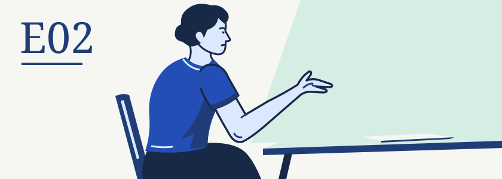
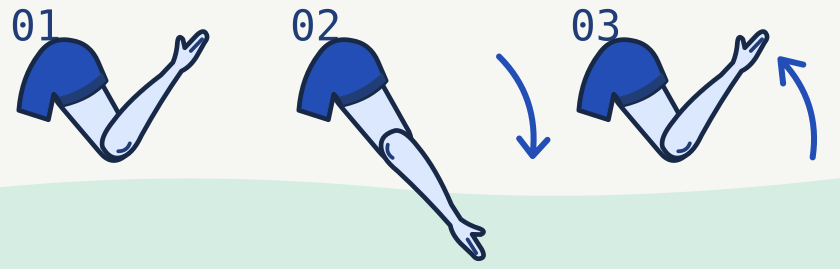

# Qolda / Қолда

**Атлас движения для домашней практики.** Qolda показывает три фазы разгибания локтя и помогает сверить с ними короткое видео. Запись обрабатывается на вашем компьютере. В дневнике видно, распознала ли модель полный цикл.

[Быстрый старт](#быстрый-старт) · [Для жюри](docs/SUBMISSION.md) · [Қазақша](docs/README.kk.md)



## Быстрый старт

**Без модели** можно посмотреть атлас. **Для проверки видео** нужна модель A.

Для просмотра: Windows, Python 3.11. Из корня клона в PowerShell:

```powershell
.\infra\serve.ps1 -PreviewOnly
```

Откройте `http://127.0.0.1:8870/` **на этом же ПК**. В режиме `PreviewOnly` доступны карта движения и инструкция; видео не анализируется.

**Проверить своё видео.** В подготовленном комплекте запустите `windows/Qolda.exe`; папки `windows/` и `engine-win64/` должны лежать рядом. Дождитесь надписи «модель A готова». Тот же движок можно открыть в браузере по адресу `http://127.0.0.1:8765/`.

Если у вас только исходники, [обучите модель A на открытых данных](docs/TRAINING-ON-ANOTHER-PC.md), затем [соберите и запустите Web или Windows](docs/WINDOWS-FROM-SOURCE.md). Для анализа нужна NVIDIA GPU с поддержкой CUDA, для окна Windows — WebView2 Runtime. Записей участников, весов и готовых сборок в Git нет.

## Один цикл E02



**01 Сгиб · 02 Разгибание · 03 Возврат.** Схема показывает порядок движения, а не заданный угол. Для записи выберите вид сбоку: плечо, локоть и запястье должны попадать в кадр.

1. **Выберите клип.** Нажмите «Начать проверку» → «Видео». Выберите свой или разрешённый вам MP4 с одним циклом, до 30 секунд. Включать камеру не нужно.
2. **Подтвердите обработку.** В форме согласия проверьте адрес локального анализатора. Дайте согласие и нажмите «Отправить на анализ».
3. **Откройте «Дневник».** Если модель распознала полный цикл, в дневнике появится «Выполнено», если неполный — «Проверьте инструкцию». Если рука не видна, попытка не засчитывается. Повтор того же файла не добавляет второй цикл.

## Что проверено

- **Web и Windows x64.** На контрольном ПК путь от локального MP4 до записи в дневнике пройден [в Chromium](reports/release/web-e02-canonical.md) и [в окне Qolda.exe](reports/release/captain-acceptance.md). Поток проверяли отдельно, на воспроизведённых кадрах, не с физической камеры. Чистый Windows-ноутбук не проверяли.
- **Android ARM64.** [Собраны AAR и подписанный debug APK](docs/ANDROID-FROM-SOURCE.md). Полный прогон на телефоне без сети и кабеля пока не подтверждён.
- **Другие упражнения.** [Поднятие предмета (E01)](reports/ml/extra-e01.md) и [разгибание запястья (E03)](reports/ml/extra-e03.md) — отдельные исследования. Они и варианты E02 B/C не входят в проверенный сценарий E02/A.

## Что означают результаты

RTMPose находит видимые точки правого локтя и запястья. По тому, как они движутся от кадра к кадру, обученная командой временная сеть (TCN) различает полный и неполный циклы. Qolda не измеряет угол сустава или боль, не ставит диагноз и не назначает лечение. [Как устроен анализатор](docs/ARCHITECTURE.md).

На этапе разработки модель проверяли на **20 клипах одного участника**: 10 полных и 10 неполных циклов. Сбалансированная точность (*balanced accuracy*) на этом разбиении — **1,00 у модели A** против **0,50 у базового правила** «всегда неполный цикл» (самый частый класс при обучении). Эти клипы использовали при выборе модели: это не независимый тест и не оценка клинической точности. [Матрицы ошибок и методика](docs/SUBMISSION.md#что-считает-модель-и-что-означают-числа) · [Результаты в JSON](reports/release/jury-e02-evidence.json).

## Видео и дневник

Облачный аккаунт не нужен. На ПК клип обрабатывается во временной папке: после штатного завершения она очищается, при сбое файлы могут остаться. По умолчанию дневник ведётся в памяти сеанса. Чтобы видеть записи после закрытия приложения, нужно отдельно включить сохранение на устройстве. [Проверка приватности](reports/security/current-release-privacy.md) · [Сообщить о проблеме](SECURITY.md).

Конкурсный прототип для кейса **SerIQ** на AI-Sana Shakarim Solveathon. [Паспорт данных](docs/DATA-CARD.md) · [Источники и условия использования](artifacts/seriq/ATTRIBUTION.md).
