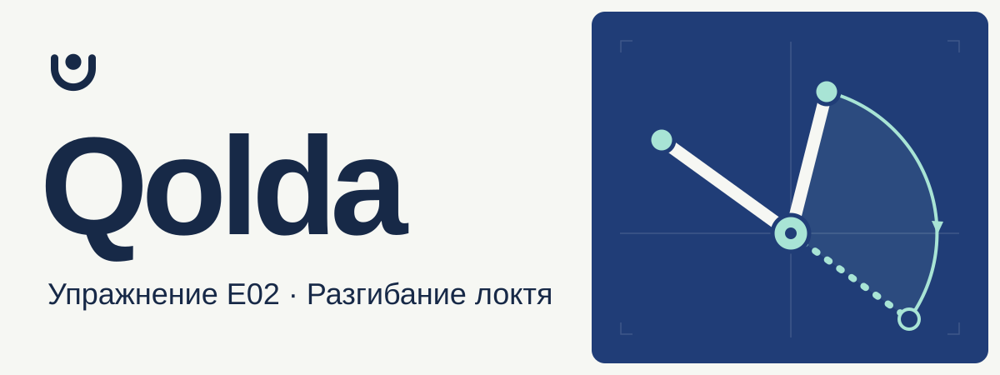

# Qolda / Қолда



**Локальный ИИ-помощник для домашней практики разгибания локтя.** Загрузи короткий клип E02, подтверди обработку и получи нейтральный результат: «Выполнено» или «Проверьте инструкцию». Сводка занятия остаётся на устройстве. Интерфейс на русском и казахском.

[Быстрый старт](#быстрый-старт) · [Для жюри](docs/SUBMISSION.md) · [Архитектура](docs/ARCHITECTURE.md) · [Қазақша](docs/README.kk.md)

Конкурсный прототип для кейса [SerIQ · AI-Sana Shakarim Solveathon](https://solveathon.shakarim.edu.kz/static/cases/seriq-brief-ru.pdf). Qolda не ставит диагноз, не измеряет боль или угол сустава и не назначает лечение.

## Что можно сделать

1. Открыть карту движения и инструкцию E02.
2. Выбрать своё или разрешённое видео одного цикла и дать согласие на обработку.
3. Получить оценку локальной модели и открыть дневник. Повтор файла не удваивает счётчик; если рука не видна, попытка не засчитывается.

| Платформа | Состояние |
|---|---|
| **Web** | В Chromium проверено: файл → NVIDIA CUDA → результат → дневник. Потоковый путь пройден на воспроизведённых кадрах, не на физической камере. |
| **Windows x64** | Нативный `Qolda.exe` запустил соседний переносимый движок. Проверены системный выбор файла и запись результата в дневнике. На чистом ноутбуке не проверялся. |
| **Android ARM64** | Собраны AAR и подписанный debug APK с локальным LiteRT GPU-движком. Полный клип на телефоне без сети и кабеля не подтверждён. |

[Протоколы и SHA контрольных сборок](reports/release/captain-acceptance.md). Основной сценарий — E02/A. E01 и E03 — [дополнительные исследования](docs/contracts/extra-exercises.md); новые E02 B/C не входят в проверенный комплект.

## Быстрый старт

### Посмотреть интерфейс без модели

Из корня клона на Windows с Python 3.11, в PowerShell:

```powershell
.\infra\serve.ps1 -PreviewOnly
```

Открой [127.0.0.1:8870](http://127.0.0.1:8870/) **на том же ПК**. Это ознакомительный режим, без результатов ИИ. Скрипт не заменяет занятый порт или работающий процесс. [Подробнее о запуске клиента](frontend/README.md#запуск).

### Запустить анализ или собрать приложение

- **Готовый локальный Windows-комплект:** `windows/Qolda.exe` и соседняя папка `engine-win64/`. Нужны NVIDIA-драйвер и WebView2 Runtime. Web-клиент этого же работающего движка открывается на `127.0.0.1:8765`.
- **Собрать из Git:** [получить открытые данные и обучить A](docs/TRAINING-ON-ANOTHER-PC.md) → [собрать и запустить Web / Windows](docs/WINDOWS-FROM-SOURCE.md). Для Android — [сборка AAR и APK из исходников](docs/ANDROID-FROM-SOURCE.md). Закрытые данные, веса и готовые платформенные сборки не входят в Git.
- **Проверить готовность:** `GET /api/v1/health`, `models.scratch: true`. При отсутствии модели или GPU клиент не выдаёт фиктивный результат и не переключается на CPU.

## Как это устроено

`Видео → RTMPose → видимые точки в движении → собственный TCN → результат → локальный дневник`

| Где | Что находится |
|---|---|
| [`frontend/`](frontend/) и [`assets/`](assets/) | Общий интерфейс, карта движения, локальные шрифты и 3D. |
| [`backend/`](backend/) и [`ml/`](ml/) | Файловый и потоковый API, обучение и классификация E02. |
| [`desktop/`](desktop/) и [`android/`](android/) | Windows WebView2 и Android WebView с нативным мостом. |
| [`tools/`](tools/) и [`infra/`](infra/) | Подготовка development-данных, сборка, экспорт и запуск. |
| [`docs/`](docs/) и [`reports/`](reports/) | Инструкции, контракты, протоколы и ограничения. |

## Результаты и приватность

На development-валидации E02/A распознала **10 полных и 10 неполных циклов**. Balanced accuracy — **1,00** против **0,50** у правила, прогнозирующего наиболее частый класс train. Те же клипы прошли через упакованный файловый API; пустая сцена дала `no_pose`. Это один участник, использованный при выборе модели, **не независимый тест**. [Матрица ошибок, F1 и воспроизведение](docs/SUBMISSION.md#что-считает-модель-и-что-означают-числа).

Анализ выполняется локально. По умолчанию история не сохраняется на диск. Временные файлы и ограничения проверки описаны в [отчёте о приватности](reports/security/current-release-privacy.md). Сообщения об уязвимостях и инцидентах — [приватно, без пользовательских материалов](SECURITY.md).

[Паспорт данных](docs/DATA-CARD.md) · [Источники и условия сторонних компонентов](artifacts/seriq/ATTRIBUTION.md). Лицензии зависимостей не задают автоматически лицензию для всего исходного кода Qolda.
