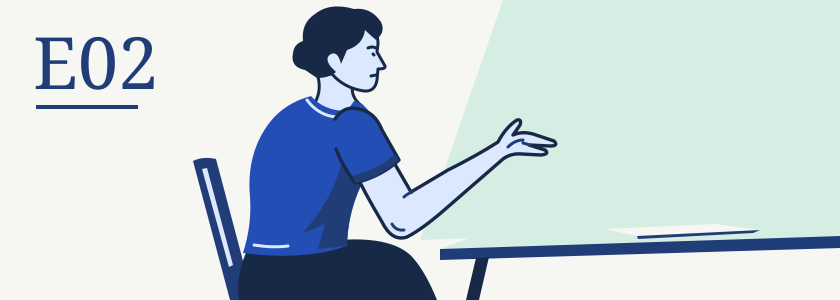
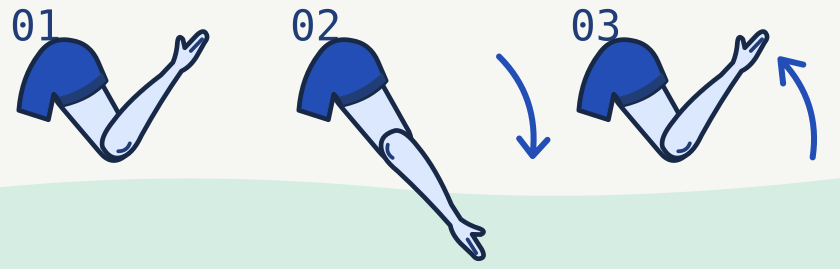

# Qolda / Қолда

**Үйде жаттығуға арналған қозғалыс атласы.** Qolda шынтақты жазу қимылын кезең-кезеңімен көрсетеді. Қысқа бейнежазбаны өз компьютеріңізде тексеріп, қимылдың толық циклі танылғанын не танылмағанын күнделіктен көре аласыз.

[Іске қосу](#іске-қосу) · [Қазылар алқасына](SUBMISSION.md) · [Русский](../README.md)



## Іске қосу

**Модельсіз** атласты көруге болады. **Бейнені тексеру үшін** A моделі қажет.

Атласты көру үшін Windows пен Python 3.11 қажет. PowerShell ішінде репозиторийдің түпкі қалтасынан:

```powershell
.\infra\serve.ps1 -PreviewOnly
```

Осы компьютерде `http://127.0.0.1:8870/` мекенжайын ашыңыз. `PreviewOnly` режимінде қозғалыс картасы мен нұсқаулық қолжетімді, бірақ бейне талданбайды.

**Бейнені талдау.** Дайын Windows жинағында `windows/Qolda.exe` файлын іске қосыңыз. `windows/` және `engine-win64/` қалталары қатар тұруы керек. A моделі дайын болғанда, сол талдағышты браузерде де аша аласыз: `http://127.0.0.1:8765/`.

Тек бастапқы код болса, алдымен [ашық деректермен A моделін үйретіңіз](TRAINING-ON-ANOTHER-PC.md), содан кейін [Web немесе Windows нұсқасын құрастырыңыз](WINDOWS-FROM-SOURCE.md). Талдауға CUDA қолдайтын NVIDIA графикалық процессоры, ал Windows қолданбасына WebView2 Runtime қажет. Қатысушылардың жазбалары, модель салмақтары және дайын жинақтар Git репозиторийіне кірмейді.

## E02 жаттығуының бір циклі



**01 Бүгу · 02 Жазу · 03 Қайтару.** Сызба қимылдың ретін көрсетеді, бұрыштың үлгісін емес. Бейнежазбада иық, шынтақ және білезік бүйірден көрінуі керек.

1. **Бейне таңдаңыз.** «Тексеруді бастау» → «Бейне» тармағында бір циклдің қысқа MP4 жазбасын таңдаңыз (30 секундқа дейін). Өзіңіздің немесе пайдалануға рұқсатыңыз бар бейнені ғана алыңыз. Камераны қосудың қажеті жоқ.
2. **Өңдеуге келісім беріңіз.** Келісім терезесінде жергілікті талдағыштың мекенжайы көрсетіледі. Мекенжайды тексеріп, «Талдауға жіберу» түймесін басыңыз.
3. **«Күнделік» бөлімін ашыңыз.** Толық цикл танылса, «Орындалды», толық емес цикл танылса, «Нұсқаулықты тексеріңіз» деген белгі шығады. Қол көрінбесе, әрекет саналмайды. Бір файлды қайта тексергенде екінші жазба қосылмайды.

## Не тексерілді?

- **Web және Windows x64.** Бақылау компьютерінде жергілікті MP4 файлынан бастап күнделіктегі нәтижеге дейінгі жол [Chromium браузерінде](../reports/release/web-e02-canonical.md) және [Qolda.exe терезесінде](../reports/release/captain-acceptance.md) тексерілді. Ағындық өңдеуде камераның орнына бұрын жазылған кадрлар қолданылды. Жаңадан орнатылған Windows жүйесінде тексеріс жүргізілген жоқ.
- **Android ARM64.** [AAR және қолтаңбасы бар debug APK құрастырылды](ANDROID-FROM-SOURCE.md). Телефонда толық бейнені желісіз және кабельсіз өңдеу әлі расталған жоқ.
- **Басқа жаттығулар.** [Затты көтеру (E01)](../reports/ml/extra-e01.md) және [білезікті жазу (E03)](../reports/ml/extra-e03.md) — бөлек зерттеулер. Олар да, E02 B/C нұсқалары да тексерілген E02/A сценарийіне кірмейді.

## Нәтижені қалай түсінуге болады?

RTMPose оң жақ шынтақ пен білезіктің кадрда көрінетін нүктелерін табады. Команда үйреткен TCN желісі сол нүктелердің қозғалысына қарап, толық циклді толық емес циклден ажыратады. Жүйе буын бұрышын да, ауырсынуды да өлшемейді, диагноз қоймайды және ем тағайындамайды. [Талдағыштың құрылысы](ARCHITECTURE.md).

Модельді әзірлеу кезінде **бір қатысушының 20 бейнесі** тексерілді: 10 толық және 10 толық емес цикл. Осы жиынтықтағы теңгерімді дәлдік (*balanced accuracy*) **A моделінде — 1,00**, ал әр жолы «толық емес цикл» деп болжайтын **базалық ережеде — 0,50**. Бұл оқыту жиынтығында ең жиі кездескен класс еді. Тексеру жиынтығы модельді таңдау үшін де қолданылды. Сондықтан бұл тәуелсіз сынақ емес әрі клиникалық дәлдікті көрсетпейді. [Әдістеме мен қателер матрицалары](SUBMISSION.md#что-считает-модель-и-что-означают-числа) · [JSON нәтижелері](../reports/release/jury-e02-evidence.json).

## Бейне мен күнделік

Бұлттағы тіркелгі қажет емес. Компьютерде бейне уақытша қалтада өңделеді. Өңдеу қалыпты аяқталса, қалта тазартылады; ақау болса, файлдар қалуы мүмкін. Әдепкіде күнделік сеанс аяқталғанша ғана сақталады. Жазбаларды келесі жолы да көру үшін құрылғыда сақтауды бөлек қосу керек. [Құпиялық туралы есеп](../reports/security/current-release-privacy.md) · [Мәселе туралы хабарлау](../SECURITY.md).

**SerIQ** кейсіне арналған AI-Sana Shakarim Solveathon байқауының прототипі. [Деректер паспорты](DATA-CARD.md) · [Дереккөздер мен пайдалану шарттары](../artifacts/seriq/ATTRIBUTION.md).
